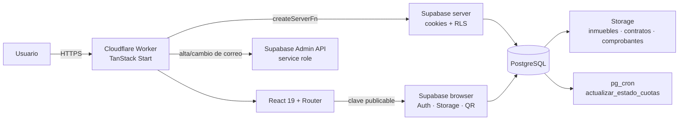
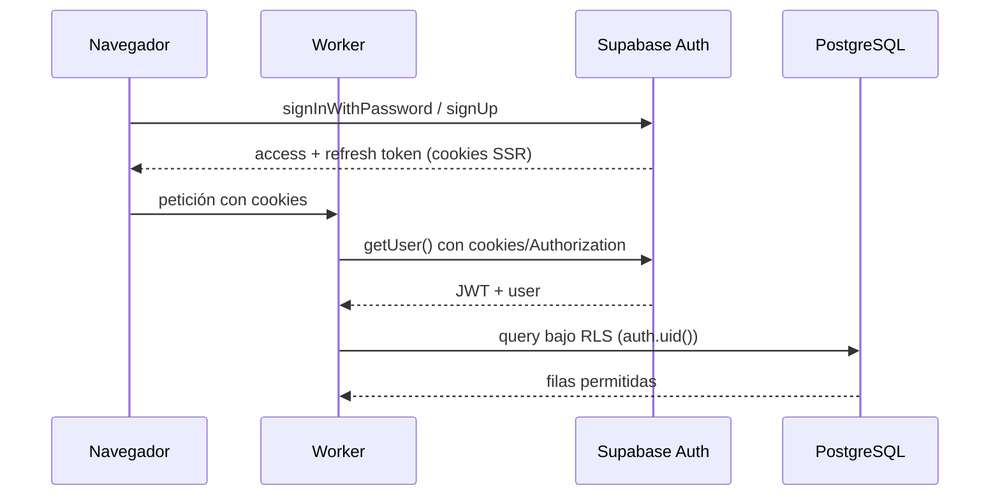

# Arquitectura — RE/MAX Potosí

Última actualización: 2026-10-28 (fase 5).

## 1. Vista general

Estado real: todas las pantallas consumen Supabase. No queda ningún import de
`src/data`; el modelo de transporte vive en `src/types/models.ts`. Las únicas
acciones fuera de la base son institucionales (correo/teléfono de la oficina y
redes sociales) y se configuran en `src/lib/site.ts`.

## 2. Capas

### Frontend

- TanStack Start + Router file-based; `src/routes/` contiene 23 pantallas.
- Componentes de dominio en `src/components/`, UI shadcn vendorizada en
  `src/components/ui/`.
- Estado local y validaciones de formulario; las rutas cargan datos con
  `loader` + server functions y los envíos muestran `toast` con el resultado.
- Tema claro/oscuro/sistema con `ThemeProvider` y tokens CSS.
- Tipos de transporte en `src/types/models.ts`; `database.types.ts` describe el
  esquema y `src/types/*.ts` los DTO de cada módulo.
- La landing lee agentes, métricas, zonas y destacados reales. Las secciones
  puramente institucionales usan `src/lib/site.ts`.

### Servidor (TanStack Start en Workers)

- `src/lib/supabase/server.ts`: cliente por petición con cookies y header
  `Authorization`. Usa clave publicable, por lo que **RLS sigue aplicando**.
- `src/server/supabase-admin.ts`: singleton con service role, solo servidor.
  Salta RLS; se reserva para la Admin API de Auth y tareas administrativas.
- `src/server/auth.ts`, `catalogo.ts`, `visitas.ts`, `paneles.ts`,
  `admin/*` y `alquileres/*`: server functions de lectura y mutación. Las
  lecturas usan cookies + RLS; las mutaciones críticas llaman a RPC.
- `src/server/usuarios.ts`: alta de cuentas y cambio de correo con service role;
  siempre valida el rol del solicitante antes de usar la Admin API.
- El worker se despliega con Wrangler; `nodejs_compat` habilita `process.env`
  para secretos.

### Base de datos

- PostgreSQL de Supabase con 16 tablas, 12 enums, RLS, triggers, RPC y vistas.
- Migraciones numeradas como fuente de verdad; `full_setup.sql` es el bundle
  para pegar en el editor SQL.
- Storage con tres buckets; políticas sobre `storage.objects`.
- `pg_cron` ejecuta la actualización diaria de cuotas.

## 3. Flujos

### Autenticación (conectada)

- El cliente de navegador (`createBrowserClient`) escribe cookies de sesión.
- El cliente de servidor (`createServerClient`) las lee y las refresca.
- El rol **no** viaja como claim de confianza para autorizar: RLS lee
  `public.perfiles.rol` con `security definer`.
- Alta de usuarios internos: `crearUsuarioVendedor`/`crearUsuarioCliente` usan
  Admin API con `app_metadata.creado_por_backend = true`. Un auto-registro
  siempre nace `cliente`.

### Lectura de datos

1. El `loader` de la ruta llama a un `createServerFn` (o el componente usa el
   cliente de navegador para Auth/Storage).
2. La consulta usa vistas (`v_*`) o tablas; RLS filtra por rol y pertenencia.
3. La vista devuelve campos ya resueltos (zona, nombres, próxima cuota) para
   evitar consultas N+1.
4. El servidor mapea la fila a un DTO estable; la UI no depende de la forma
   cruda de la tabla.

### Escrituras de negocio (RPC)

| Flujo | RPC | Efecto atómico |
|---|---|---|
| Agendar visita | `agendar_visita` | Valida disponibilidad/solape, resuelve cliente y crea visita. |
| Cerrar alquiler | `registrar_alquiler` | Alquiler + cuotas + pago de cierre + comisión + inmueble `en_alquiler`. |
| Cobrar cuota | `registrar_pago_cuota` | Pago + validación de monto + cuota pagada + aviso. |
| Promover vendedor | `promover_a_vendedor` | Rol + fila de vendedor + comisión. |
| Cambiar inmueble | `cambiar_estado_inmueble` | Bloquea `disponible/inactivo` si hay contrato vigente. |
| Job diario | `actualizar_estado_cuotas` | Mora, recargo y avisos deduplicados. |

No replicar estas reglas en TypeScript. La UI solo valida para dar feedback.

### Archivos

1. El wizard genera el UUID del alquiler en el cliente.
2. Sube contrato/comprobante a `contratos` o `comprobantes` con ruta
   `{alquiler_id}/archivo`; la política permite al vendedor crear aunque el
   alquiler aún no exista.
3. Llama a `registrar_alquiler` con `contrato_path` y `comprobante_path`.
4. Lectura posterior: admin, vendedor o cliente del alquiler.
5. Fotos de inmuebles: bucket público `inmuebles`; `inmueble_imagenes.path`
   guarda la ruta y `url` la URL pública. Desde 0010, la escritura queda limitada
   al administrador o al agente asignado al inmueble de la carpeta.

## 4. Seguridad

- **RLS en todas las tablas**. Los `GRANT` habilitan operaciones; las políticas
  deciden filas. `anon` tiene SELECT nominal para las vistas del catálogo, pero
  sin políticas solo ve inmuebles disponibles y zonas activas.
- **Helpers `security definer`** (`puede_ver_alquiler`, `puede_ver_inmueble`,
  `es_agente_de_inmueble`, `current_rol`, nombres públicos) evitan recursión de
  políticas y consultas cruzadas no autorizadas. Todos fijan `search_path = ''`
  y califican objetos.
- **Rol protegido**: trigger `proteger_rol` impide que un usuario no admin
  modifique `perfiles.rol`; `proteger_campos_perfil` bloquea estado, correo y
  bandera de contraseña temporal.
- **Visitas**: `proteger_campos_visita` (0009) deja al cliente solo cancelar
  visitas pendientes propias y al vendedor solo confirmar/cancelar las suyas;
  cualquier otro campo exige administrador.
- **Service role**: solo en `src/server/*`; nunca en `VITE_*`. Los cuerpos de
  `createServerFn` no llegan al bundle cliente, pero la disciplina de imports se
  mantiene.
- **Storage**: contratos/comprobantes privados; la primera carpeta debe ser un
  UUID de alquiler. Fotos de inmuebles: lectura pública, escritura solo admin o
  agente asignado (0010).
- **Auditoría**: cambios de inmuebles, alquileres, pagos, rol y comisión fija.
- **JWT**: no se confía en metadatos del usuario para el rol; se consulta el
  perfil activo en base de datos.

### Riesgos conocidos

- `pagos.validado = false` de un cliente no bloquea el marcado de la cuota como
  pagada; no hay aprobación posterior. El pago queda visible para validación.
- `pg_cron` no se ejecutó en una base local; debe comprobarse en Supabase.
- El alta/cambio de correo usa service role; cualquier cambio futuro debe
  mantener la validación de rol en `src/server/`.
- La configuración de Redirect URLs de Supabase debe incluir el dominio de
  producción para futuros flujos de recuperación de contraseña.

## 5. Despliegue

- Build: `vite build` genera `dist/client` y `dist/server`.
- Runtime: Cloudflare Workers (`wrangler.jsonc`, `nodejs_compat`).
- Variables: ver [DEPLOYMENT.md](DEPLOYMENT.md). Las `VITE_*` se hornean en
  build; los secretos de servidor se cargan en Wrangler.
- `scripts/seed-users.ts`, `SUPABASE_DB_URL` y los tests SQL no se despliegan.
