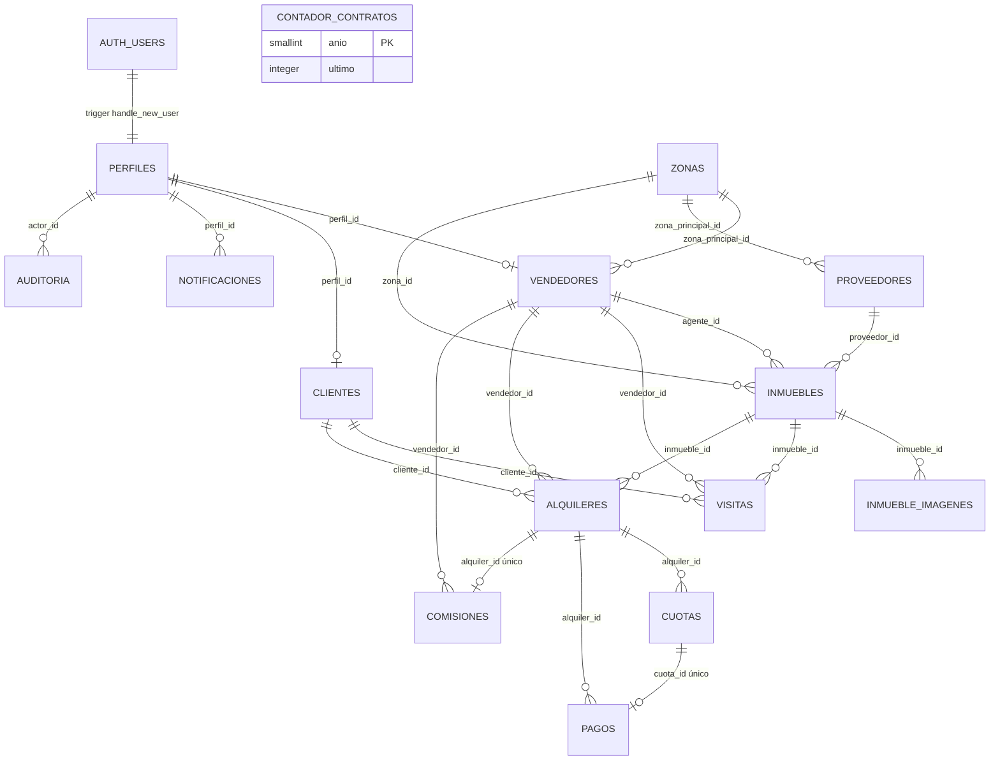

# Base de datos — RE/MAX Potosí

Última actualización: 2026-10-28. Fuente de verdad:
`supabase/migrations/0001…0010`. No editar migraciones aplicadas.

## 1. Modelo entidad-relación



`perfiles.id` es la misma PK de `auth.users.id`. Los gestores no tienen tabla:
son perfiles con rol `administrador` o `vendedor`.

## 2. Tablas

| Tabla | Propósito / claves |
|---|---|
| `zonas` | Zonas urbanas por sector; `slug` único, `activo`. |
| `perfiles` | Datos de negocio 1:1 con Auth; `rol`, `activo`, correo único (case-insensitive), CI único parcial. |
| `vendedores` | 1:1 con perfil; `comision_fija` (snapshot para comisiones), cargo, zona, activo. |
| `clientes` | 1:1 con perfil; teléfono de contacto y dirección. |
| `proveedores` | Propietario persona/empresa; contacto, zona, activo. FK `RESTRICT` desde inmuebles. |
| `inmuebles` | Catálogo; código único, tipo, estado, precio, m2, habitaciones, dirección, zona, proveedor, agente, disponibilidad, costo de publicación. `habitaciones = null` si tipo `local`. |
| `inmueble_imagenes` | Fotos; `url` externa o `path` de Storage, orden y una sola portada por inmueble. |
| `visitas` | Cita; cliente nullable (anónimo con contacto obligatorio), vendedor nullable, fecha, estado, canal, notas. Índice único de franja pendiente. |
| `alquileres` | Contrato; `numero_contrato` único, partes, fechas, monto, día de cobro (1–28), depósito, estado, contrato en Storage. Único `vigente` por inmueble. |
| `cuotas` | Cronograma; número único por alquiler, vencimiento, monto, recargo, estado. |
| `pagos` | Cobro de cierre o cuota; monto, medio, fecha, comprobante, quién registró, `validado`. Una cuota tiene como máximo un pago. |
| `comisiones` | Una por alquiler; monto snapshot, fecha, estado. |
| `notificaciones` | Avisos internos por perfil; `(perfil_id, tipo, referencia)` deduplica. |
| `configuracion` | Fila única (`id = 1`): % mora, días de gracia, días de aviso. |
| `auditoria` | Snapshots JSON de cambios sensibles; actor y fecha. |
| `contador_contratos` | Secuencia por año para `RMX-YYYY-0001`. |

Convenciones: `uuid` con `gen_random_uuid()`, `timestamptz`, `numeric(12,2)`
para dinero, `created_at/updated_at` y trigger `set_updated_at`.

## 3. Enums

| Enum | Valores |
|---|---|
| `rol_usuario` | `administrador`, `vendedor`, `cliente` |
| `tipo_inmueble` | `casa`, `departamento`, `local` |
| `estado_inmueble` | `disponible`, `reservado`, `en_alquiler`, `inactivo` |
| `estado_visita` | `pendiente`, `realizada`, `cancelada` |
| `canal_visita` | `web`, `telefono`, `presencial` |
| `estado_alquiler` | `vigente`, `finalizado`, `suspendido`, `cancelado` |
| `estado_cuota` | `pendiente`, `pagada`, `en_mora`, `anulada` |
| `tipo_pago` | `cierre`, `cuota` |
| `medio_pago` | `tarjeta`, `qr`, `efectivo`, `otro` |
| `estado_comision` | `pendiente`, `pagada`, `anulada` |
| `tipo_notificacion` | `visita_agendada`, `visita_asignada`, `cuota_por_vencer`, `cuota_en_mora`, `pago_registrado`, `alquiler_cerrado`, `sistema` |
| `tipo_proveedor` | `persona`, `empresa` |

## 4. Triggers

| Trigger | Tabla | Efecto |
|---|---|---|
| `on_auth_user_created` | `auth.users` | Crea perfil. Rol solo desde `app_metadata` si `creado_por_backend = true`; si no, cliente. |
| `perfiles_cliente_automatico` | `perfiles` | Crea fila en `clientes` al nacer/rol cliente. |
| `perfiles_proteger_rol` | `perfiles` | Bloquea cambio de rol salvo admin/service. |
| `perfiles_proteger_campos` | `perfiles` | Bloquea auto-cambio de `activo`, `correo`, `debe_cambiar_password`. |
| `visitas_validar_vendedor` | `visitas` | Exige vendedor activo con rol vendedor. |
| `alquileres_estado_cambiado` | `alquileres` | Libera inmueble y anula cuotas al finalizar/cancelar; marca `en_alquiler` al volver a vigente. |
| `pagos_validar` | `pagos` | Valida cuota, pertenencia, estado, alquiler vigente y monto suficiente. |
| `pagos_aplicar` | `pagos` | Marca cuota pagada y crea aviso de pago. |
| `notificaciones_proteger_propia` | `notificaciones` | Solo permite marcar leída; no mover ni editar contenido. |
| `*_auditar` | inmuebles, alquileres, pagos, perfiles (rol), vendedores (comisión) | Inserta snapshot en `auditoria`. |
| `trg_*_updated_at` | todas las tablas | Actualiza `updated_at`. |

## 5. Funciones y RPC

### RPC de negocio

| Firma | Permiso | Propósito |
|---|---|---|
| `agendar_visita(uuid, timestamptz, text, text, text, text, canal_visita, uuid, uuid) → uuid` | `anon`, `authenticated`, `service_role` | Crea visita; valida disponibilidad, fecha, solape ±1 h, contacto y cliente. Advisory lock por inmueble. |
| `promover_a_vendedor(uuid, numeric, text, uuid) → void` | admin o service | Cambia rol y crea/actualiza vendedor en una transacción. |
| `registrar_alquiler(uuid, uuid, uuid, uuid, numeric, timestamptz, integer, text, jsonb, numeric, smallint) → uuid` | admin, vendedor dueño o service | Cierre atómico: alquiler + cuotas + pago + comisión + inmueble. |
| `registrar_pago_cuota(uuid, uuid, numeric, medio_pago, text, timestamptz, uuid) → uuid` | admin, vendedor/cliente del alquiler o service | Cobra cuota, valida monto y delega marcado a triggers. |
| `cambiar_estado_inmueble(uuid, estado_inmueble) → void` | admin o service | Cambia estado; bloquea disponible/inactivo con contrato vigente. |
| `actualizar_estado_cuotas() → void` | `service_role` | Job diario: mora, recargo, avisos. |
| `siguiente_numero_contrato(integer) → text` | `service_role` | Contador atómico `RMX-YYYY-0001`. |
| `calcular_recargo_mora(uuid) → numeric` | authenticated/service | 5 % si superó vencimiento + gracia; 0 si pagada/anulada. |

### Helpers internos / RLS

| Firma | Uso |
|---|---|
| `current_rol() → rol_usuario` | Rol del perfil activo de `auth.uid()`. |
| `is_admin() → boolean` | Atajo de rol administrador. |
| `is_vendedor() → boolean` | Atajo de rol vendedor. |
| `es_cliente_de_alquiler(uuid)`, `es_vendedor_de_alquiler(uuid)` | Pertenencia a contrato. |
| `puede_ver_alquiler(uuid)` | Admin, cliente o vendedor del contrato. |
| `puede_ver_inmueble(uuid)` | Disponible, admin, agente/cartera/visita del vendedor o cliente del alquiler. |
| `es_agente_de_inmueble(uuid)` | `inmuebles.agente_id = auth.uid()`. |
| `nombre_persona(uuid)`, `nombre_agente(uuid)`, `nombre_proveedor(uuid)` | Nombres para vistas sin exponer contacto. |
| `alquiler_id_de_archivo(text)` | Extrae UUID de la primera carpeta de Storage. |
| `inmueble_id_de_archivo(text)` | Extrae UUID del inmueble de la carpeta de fotos. |
| `es_agente_de_archivo_inmueble(text)` | Valida escritura de fotos del agente asignado. |
| `proteger_campos_visita()` | Trigger: cliente/vendedor solo cambian el estado permitido. |
| `puede_ver_archivo_alquiler(text)` | Lectura de contrato/comprobante. |
| `puede_subir_archivo_alquiler(text)` | Alta admin/vendedor, incluso antes del contrato. |
| `puede_editar_archivo_alquiler(text)` | Edición/borrado admin o vendedor asignado. |

Todas las funciones `security definer` usan `set search_path = ''` y objetos
calificados. `EXECUTE` se revoca de `public` y se otorga explícitamente.

## 6. Vistas

Todas con `security_invoker = true`; respetan RLS de las tablas base.

| Vista | Contenido |
|---|---|
| `v_inmuebles_catalogo` | Inmueble + zona + nombres de proveedor/agente + portada + galería JSON. |
| `v_zonas_con_conteo` | Zonas con total, disponibles, en alquiler y reservados. |
| `v_cuotas_estado` | Cuota + estado derivado (`Al día`, `Por vencer`, `En mora`, `Pagada`, `Anulada`), monto total y días para vencer. |
| `v_alquileres_detalle` | Contrato + inmueble + cliente + vendedor + próxima cuota + totales pagados/pendientes + comisión. |
| `v_comisiones_vendedor` | Comisión + contrato + inmueble + cliente + vendedor. |
| `v_dashboard_admin` | KPIs: inmuebles activos, visitas de la semana, alquileres vigentes, cobros del mes, mora y morosidad. |

## 7. Matriz RLS

Leyenda: ✅ permitido; 👁 solo filas propias/asignadas; ⛔ sin acceso; ✍️ lectura
y escritura; `S` service role (bypass).

| Tabla | anon | cliente | vendedor | admin |
|---|---|---|---|---|
| `zonas` | 👁 activas | 👁 activas | 👁 activas | ✍️ |
| `perfiles` | ⛔ | 👁 propio + update propio limitado | 👁 propio + perfiles de clientes | ✍️ |
| `vendedores` | ⛔ | ⛔ | 👁 propio | ✍️ |
| `clientes` | ⛔ | 👁/update propio | 👁 todos (pickers) | ✍️ |
| `proveedores` | ⛔ | ⛔ | 👁 | ✍️ |
| `inmuebles` | 👁 disponibles | 👁 disponibles + alquilado propio | 👁 disponibles + cartera/asignados/visitas/alquileres | ✍️ |
| `inmueble_imagenes` | 👁 de inmuebles visibles | 👁 de inmuebles visibles | 👁 visibles + ✍️ si es agente | ✍️ |
| `visitas` | ⛔ | 👁/update propias | 👁/update asignadas | ✍️ |
| `alquileres` | ⛔ | 👁 propios | 👁 propios | ✍️ |
| `cuotas` | ⛔ | 👁 de sus alquileres | 👁 de sus alquileres | ✍️ |
| `pagos` | ⛔ | 👁 de sus alquileres | 👁 de sus alquileres | ✍️ |
| `comisiones` | ⛔ | ⛔ | 👁 propias | ✍️ |
| `notificaciones` | ⛔ | 👁/update propias (solo leída) | 👁 propias | ✍️ |
| `configuracion` | ⛔ | 👁 | 👁 | ✍️ |
| `auditoria` | ⛔ | ⛔ | ⛔ | 👁 |
| `contador_contratos` | ⛔ | ⛔ | ⛔ | 👁 |

Los INSERT de negocio pasan por RPC `security definer`; por eso no hay políticas
de INSERT para clientes/vendedores en cuotas, pagos o comisiones.

### Storage

| Bucket | Público | Límite / MIME | Lectura | Alta | Edición/borrado |
|---|---|---|---|---|---|
| `inmuebles` | Sí | 8 MB; JPEG/PNG/WebP/AVIF | Público | Admin/vendedor | Admin/vendedor |
| `contratos` | No | 15 MB; PDF | Admin/vendedor/cliente del alquiler | Admin/vendedor (incluso antes del contrato) | Admin/vendedor asignado |
| `comprobantes` | No | 10 MB; PDF/JPEG/PNG/WebP | Admin/vendedor/cliente del alquiler | Admin/vendedor (incluso antes del contrato) | Admin/vendedor asignado |

Ruta obligatoria en privados: `{alquiler_id}/archivo`. Una ruta con primera
carpeta no UUID se rechaza.

## 8. Cron

`0007_cron.sql` crea `pg_cron` y programa:

```sql
select cron.schedule(
  'remax-actualizar-cuotas',
  '5 4 * * *', -- 00:05 America/La_Paz
  $$select public.actualizar_estado_cuotas();$$
);
```

El job marca mora tras 5 días de gracia, calcula el recargo y crea avisos
`cuota_en_mora` / `cuota_por_vencer` sin duplicar. Si el proyecto no tiene
`pg_cron`, omitir 0007 y llamar `select public.actualizar_estado_cuotas()` desde
un scheduler externo (service role).

## 9. Cómo aplicar

### Opción A — Supabase CLI (recomendado si está disponible)

```bash
supabase link --project-ref <ref>
supabase db push          # aplica supabase/migrations
# o, en local con Docker:
supabase db reset
```

No hay `supabase/config.toml` en este repositorio; si se usa CLI local, primero
`supabase init`.

### Opción B — editor SQL (sin CLI/Docker)

1. Crear un proyecto Supabase vacío.
2. `pnpm db:bundle`.
3. Pegar **todo** `supabase/full_setup.sql` y ejecutar.
4. Verificar que no haya errores y que existan 16 tablas y 6 vistas.
5. Crear las cuentas demo: `pnpm db:seed-users` (con `.env` completo).
6. Ejecutar `supabase/seed.sql` en el editor SQL (o definir `SUPABASE_DB_URL`
   antes del paso 5).
7. Correr `supabase/tests/verificaciones.sql` con `psql` y `ON_ERROR_STOP=1`.

### Orden de dependencias

`0001 enums` → `0002 tablas` → `0003 funciones/triggers` → `0004 RLS` →
`0005 Storage` → `0006 vistas` → `0007 cron` → `0008 password` →
`0009 seguridad pública` → `0010 storage por agente`. El seed va después de
crear los usuarios de Auth.
